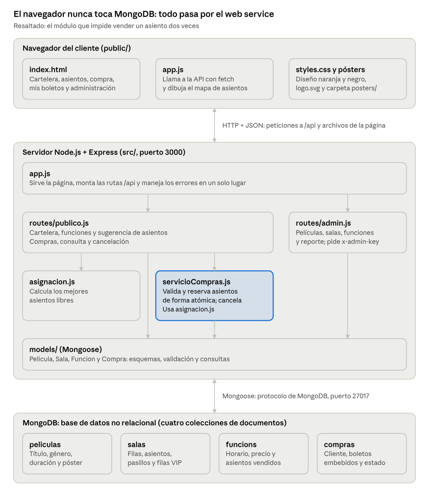
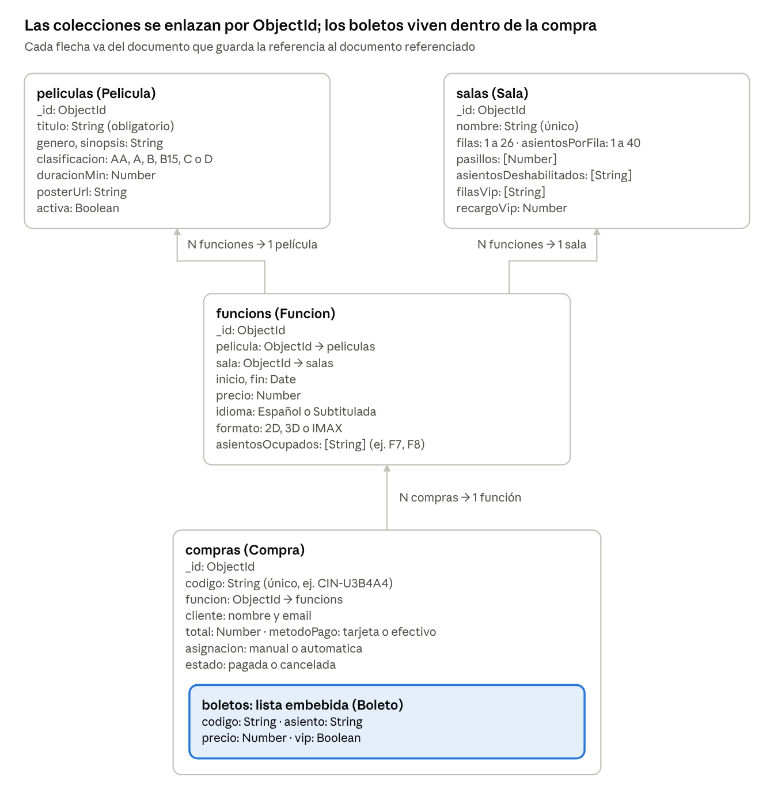
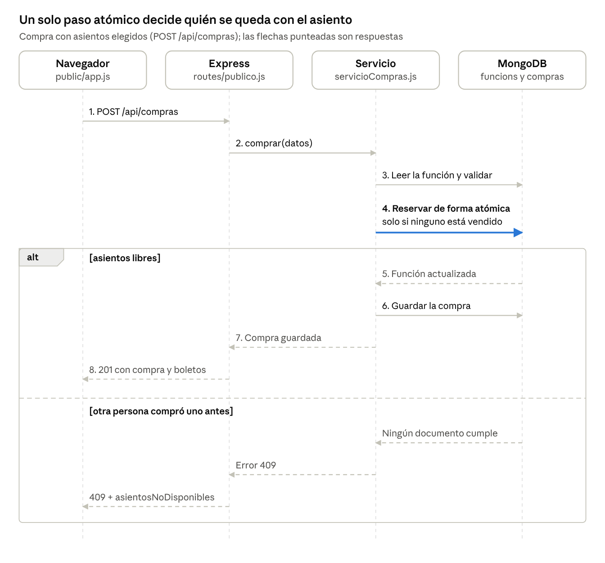
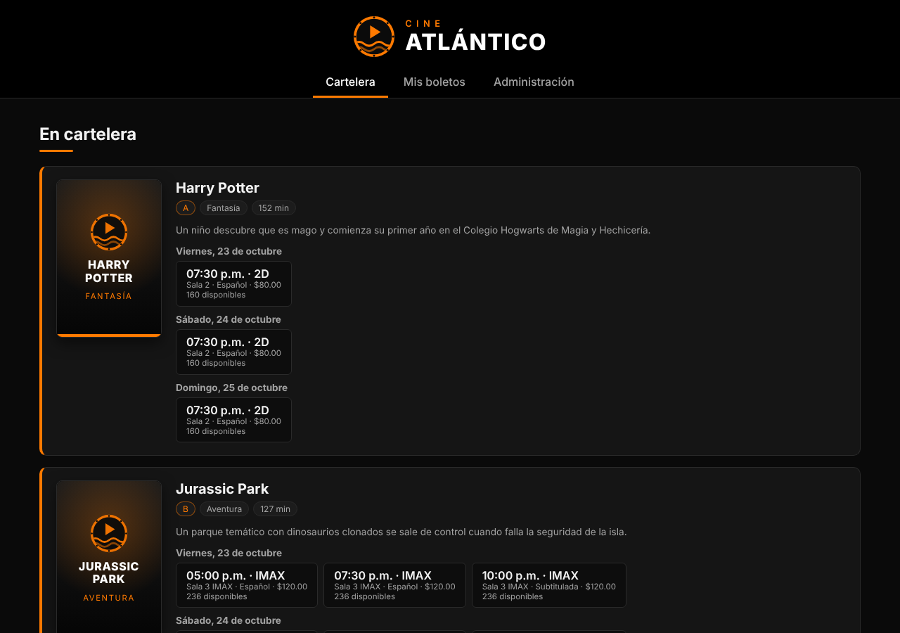
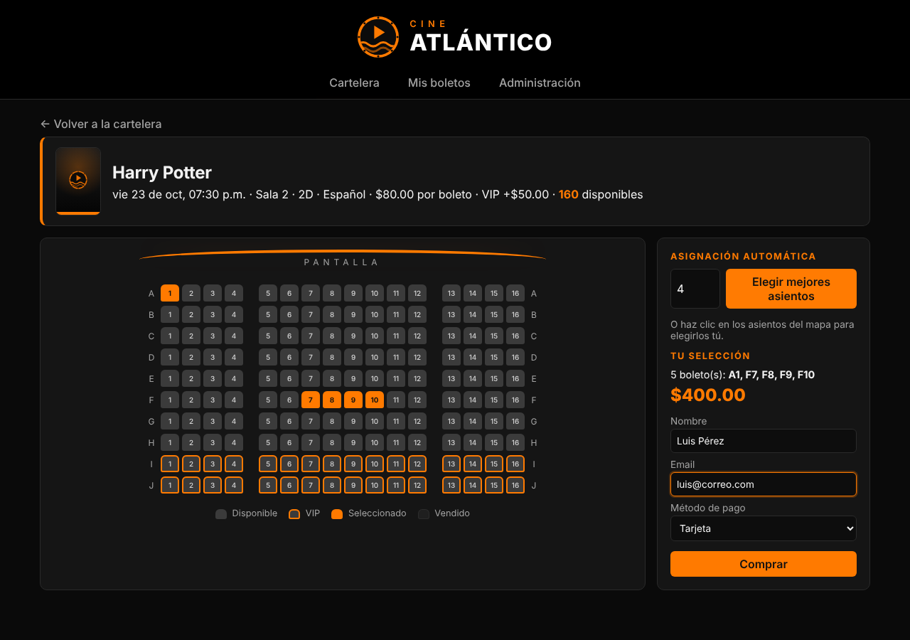
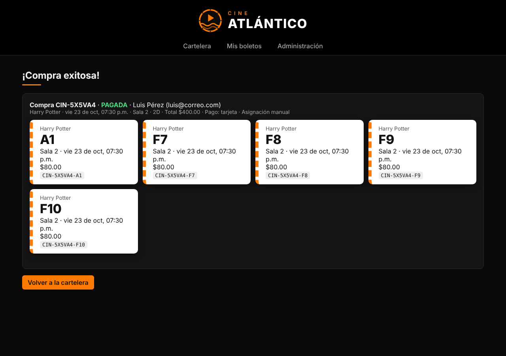
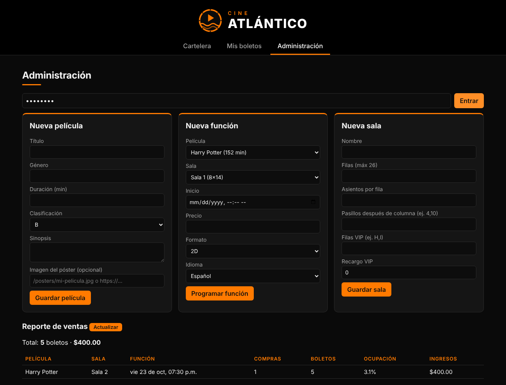

# Cine Atlántico: documentación del sistema de boletos

23 de octubre de 2026 · Leonardo Castillo

## Índice

1. [Resumen](#1-resumen)
2. [Arquitectura del sistema](#2-arquitectura-del-sistema)
3. [Tecnologías utilizadas](#3-tecnologías-utilizadas)
4. [Modelo de datos](#4-modelo-de-datos)
5. [Flujo de compra y control de concurrencia](#5-flujo-de-compra-y-control-de-concurrencia)
6. [Algoritmo de asignación automática](#6-algoritmo-de-asignación-automática)
7. [Web service REST](#7-web-service-rest)
8. [Interfaz de usuario](#8-interfaz-de-usuario)
9. [Estructura de archivos](#9-estructura-de-archivos)
10. [Instalación y ejecución](#10-instalación-y-ejecución)
11. [Pruebas automáticas](#11-pruebas-automáticas)
12. [Limitaciones y posibles mejoras](#12-limitaciones-y-posibles-mejoras)

## 1. Resumen

Cine Atlántico es una aplicación web para comprar boletos de cine y asignar asientos. Usa Node.js, Express y MongoDB, una base de datos no relacional y gratuita. Su punto central es que **un asiento nunca se vende dos veces**, aunque varias personas intenten comprarlo al mismo tiempo.

**Objetivos**

- Permitir que un cliente compre boletos desde el navegador, eligiendo sus asientos en un mapa de la sala.
- Asignar automáticamente los mejores asientos disponibles cuando el cliente lo pida.
- Dar al administrador herramientas para programar la cartelera y consultar las ventas.

**Funcionalidades**

| Área | Funcionalidad |
| --- | --- |
| Cartelera | Películas con póster, clasificación, género, duración y horarios agrupados por día |
| Selección de asientos | Mapa interactivo con pasillos, filas VIP, asientos deshabilitados y vendidos |
| Asignación automática | Elige N asientos juntos, centrados y a buena distancia de la pantalla |
| Compra | Datos del cliente, método de pago, código de compra y un boleto con código por asiento |
| Mis boletos | Consulta por código o email y cancelación, que libera los asientos |
| Administración | Alta de películas, salas y funciones, validación de horarios encimados y reporte de ventas |

**Cartelera de ejemplo:** Star Wars, Jurassic Park, Harry Potter, Minions, Parasite y Obsesión, en 3 salas (Sala 1, Sala 2 y Sala 3 IMAX).

## 2. Arquitectura del sistema

El sistema tiene tres capas: la página en el navegador, el servidor Node.js con Express y la base de datos MongoDB. El navegador nunca se conecta directamente a la base de datos; siempre pasa por el web service.



Las flechas indican quién llama a quién. Las rutas públicas leen datos directamente con los modelos, pero toda compra o cancelación pasa por `servicioCompras.js`, que reserva los asientos de forma atómica. Además, `src/seed.js` usa los mismos modelos para cargar los datos de ejemplo.

| Capa | Responsabilidad | Se comunica con |
| --- | --- | --- |
| Presentación (navegador) | Mostrar las vistas y capturar lo que hace el usuario | Servidor, por HTTP con JSON |
| Aplicación (servidor) | Validar, aplicar las reglas del negocio y exponer la API REST | Navegador y MongoDB |
| Datos (MongoDB) | Guardar películas, salas, funciones y compras | Servidor, mediante Mongoose |

## 3. Tecnologías utilizadas

Todas las tecnologías son gratuitas y de código abierto o tienen un plan gratuito.

| Capa | Tecnología | Versión | Para qué se usa |
| --- | --- | --- | --- |
| Base de datos | MongoDB (Community Server o Atlas M0) | 7.x | Guarda películas, salas, funciones y compras como documentos JSON |
| Acceso a datos | Mongoose | 8.x | Define los esquemas, valida los datos y hace las consultas a MongoDB |
| Servidor | Node.js | 18 o superior (probado en 22) | Ejecuta el código JavaScript del servidor |
| Web service | Express | 4.x | Expone la API REST y sirve los archivos de la página |
| Configuración | dotenv | 16.x | Lee la dirección de la base de datos y la clave de administrador del archivo `.env` |
| Interfaz | HTML, CSS y JavaScript sin frameworks | — | Página de una sola vista con mapa de asientos |
| Pruebas | node:test y mongodb-memory-server | Node 22 / 10.x | Pruebas automáticas contra una base de datos real o en memoria |

**¿Por qué MongoDB?** Una compra con sus boletos, o una función con sus asientos vendidos, se guarda como **un solo documento**. Así, cada pantalla se resuelve con una sola consulta. Además, MongoDB garantiza que modificar un documento es una operación atómica, que es la base del control de asientos (sección 5).

## 4. Modelo de datos

La base de datos `cine` tiene cuatro colecciones. Las funciones apuntan a su película y a su sala, y las compras apuntan a su función. Los boletos no tienen colección propia: se guardan dentro de cada compra.



Todos los documentos tienen además `createdAt` y `updatedAt`, que Mongoose agrega solo. El nombre `funcions` lo genera Mongoose automáticamente a partir del modelo `Funcion`.

**Decisiones de diseño no relacional**

- **Boletos embebidos en la compra:** una sola lectura trae la compra con todos sus boletos, y nunca se consulta un boleto sin su compra.
- **Asientos vendidos dentro de la función:** el mapa de la sala se dibuja con una sola consulta, y permite reservar con una sola operación atómica (sección 5).
- **Referencias por ObjectId** entre función, película, sala y compra: esos datos cambian por separado, y Mongoose los une cuando hace falta con `populate`.

**Índices**

| Colección | Índice | Para qué |
| --- | --- | --- |
| salas | `nombre` (único) | Impedir dos salas con el mismo nombre |
| funcions | `sala` + `inicio`, y `inicio` | Detectar horarios encimados y listar la cartelera por fecha |
| compras | `codigo` (único) | Buscar una compra por su código |
| compras | `cliente.email` y `funcion` | Buscar las compras de un cliente y armar el reporte de ventas |

## 5. Flujo de compra y control de concurrencia

Dos personas nunca pueden comprar el mismo asiento: la reserva es una sola operación atómica en MongoDB, y solo la primera que llega la consigue. La otra recibe un error 409 con los asientos en conflicto.



El paso 4 es la clave. MongoDB garantiza que modificar un documento es indivisible: la condición y la escritura ocurren juntas, sin que otra compra pueda meterse en medio.

```js
Funcion.findOneAndUpdate(
  { _id: funcionId, inicio: { $gt: ahora }, asientosOcupados: { $nin: asientos } },
  { $push: { asientosOcupados: { $each: asientos } } },
  { new: true }
)
```

- **Condición:** la función todavía no empezó y ninguno de los asientos pedidos está en `asientosOcupados` (`$nin`).
- **Escritura:** si la condición se cumple, agrega los asientos a la lista (`$push`). Si no, no cambia nada y devuelve `null`.
- **Compensación:** si al guardar la compra (paso 6) ocurre un error, los asientos se liberan con `$pullAll`.
- **Asignación automática:** si otra persona gana los asientos calculados, el servicio vuelve a leer la función, recalcula los mejores asientos y reintenta hasta 15 veces, con una espera aleatoria corta entre intentos.
- **Cancelación:** el estado cambia de `pagada` a `cancelada` con otra operación atómica, para que una compra no se cancele dos veces; después se liberan sus asientos.

Este comportamiento está comprobado con pruebas automáticas: 15 compras simultáneas del mismo asiento terminan en exactamente 1 éxito y 14 rechazos (sección 11).

## 6. Algoritmo de asignación automática

El sistema elige los N asientos libres con menor puntaje, priorizando que queden juntos. Está en `src/asignacion.js`, función `mejoresAsientos(sala, ocupados, cantidad)`.

Cada asiento o bloque recibe un puntaje; **menor es mejor**:

```
p = 1.5 · | f − 0.6 · (F − 1) | + | c − (C + 1) / 2 |
```

- f = índice de la fila (A = 0) y F = número de filas. La fila ideal está al 60% hacia el fondo de la sala.
- c = columna central del bloque y C = asientos por fila. La columna ideal es el centro de la pantalla.
- El factor 1.5 hace que alejarse de la fila ideal cueste más que alejarse del centro.

**Pasos**

1. Junta los asientos vendidos y los deshabilitados en un conjunto de no disponibles.
2. Recorre cada fila buscando bloques de N asientos libres seguidos. Un pasillo corta el bloque, porque dos asientos separados por un pasillo no están juntos.
3. Calcula el puntaje de cada bloque y se queda con el menor.
4. Si no existe ningún bloque de N asientos juntos, toma los N asientos sueltos con menor puntaje.
5. Si hay menos de N asientos libres, responde que no hay disponibilidad (código 409).

**Ejemplo:** en la Sala 2 (10 filas × 16 asientos, pasillos después de las columnas 4 y 12), al pedir 4 boletos el sistema elige F7, F8, F9 y F10: la fila ideal y el centro exacto de la pantalla.

La sugerencia que ve el cliente (`GET /api/funciones/:id/sugerencia`) no reserva nada. Al pagar, el servidor vuelve a calcular y reserva de forma atómica; si otra persona ganó esos asientos, recalcula y reintenta hasta 15 veces.

## 7. Web service REST

El servidor expone un web service RESTful que intercambia datos en formato JSON sobre HTTP. La página web lo usa, pero cualquier otro programa (una app móvil, un script) podría usar las mismas rutas.

**Rutas públicas** (`src/routes/publico.js`)

| Método | Ruta | Descripción | Respuesta correcta |
| --- | --- | --- | --- |
| GET | `/api/peliculas` | Cartelera: películas activas con sus funciones próximas y asientos disponibles | 200 |
| GET | `/api/funciones/:id` | Detalle de la función, mapa de la sala y asientos ocupados | 200 |
| GET | `/api/funciones/:id/sugerencia?cantidad=N` | Mejores N asientos (no reserva nada) | 200 |
| POST | `/api/compras` | Compra con asientos elegidos o con asignación automática | 201 |
| GET | `/api/compras/:codigo` | Consulta una compra | 200 |
| GET | `/api/compras?email=...` | Compras de un cliente | 200 |
| POST | `/api/compras/:codigo/cancelar` | Cancela la compra y libera los asientos; pide el email | 200 |

**Rutas de administración** (`src/routes/admin.js`). Todas exigen el encabezado `x-admin-key` con el valor de `ADMIN_KEY`.

| Método | Ruta | Descripción |
| --- | --- | --- |
| GET, POST | `/api/admin/peliculas` | Lista o crea películas |
| PATCH | `/api/admin/peliculas/:id` | Modifica una película |
| GET, POST | `/api/admin/salas` | Lista o crea salas |
| POST | `/api/admin/funciones` | Programa una función; rechaza horarios encimados en la misma sala (con 15 min de limpieza) |
| DELETE | `/api/admin/funciones/:id` | Borra una función solo si no tiene boletos vendidos |
| GET | `/api/admin/reporte` | Ventas por función: compras, boletos, ingresos y % de ocupación |

**Ejemplo: compra con asientos elegidos**

```
POST /api/compras
{
  "funcionId": "6718f0c2a1b2c3d4e5f60718",
  "asientos": ["F7", "F8"],
  "cliente": { "nombre": "Ana López", "email": "ana@correo.com" },
  "metodoPago": "tarjeta"
}
```

Para la asignación automática se envía `"cantidad": 2` en lugar de `"asientos"`. La respuesta (201) trae la compra completa:

```json
{
  "codigo": "CIN-U3B4A4",
  "estado": "pagada",
  "asignacion": "manual",
  "total": 160,
  "boletos": [
    { "codigo": "CIN-U3B4A4-F7", "asiento": "F7", "precio": 80, "vip": false },
    { "codigo": "CIN-U3B4A4-F8", "asiento": "F8", "precio": 80, "vip": false }
  ],
  "funcion": { "inicio": "2026-10-23T19:30:00.000Z", "pelicula": { "titulo": "Harry Potter" }, "sala": { "nombre": "Sala 2" } }
}
```

**Códigos de error.** Todos los errores responden `{ "error": "mensaje" }`.

| Código | Cuándo ocurre |
| --- | --- |
| 400 | Datos inválidos: asiento inexistente, asiento repetido, email mal escrito, más de 10 boletos o función ya iniciada |
| 401 | Falta la clave de administrador o es incorrecta |
| 403 | El email no coincide con el de la compra al cancelar |
| 404 | La función, la compra o la ruta no existen |
| 409 | Conflicto: asiento ya vendido (incluye `asientosNoDisponibles`), sin cupo, compra ya cancelada u horario encimado |
| 500 | Error interno inesperado |

## 8. Interfaz de usuario

La interfaz es una sola página (`public/index.html`) que cambia de vista sin recargar. `public/app.js` hace las peticiones al web service y dibuja cada vista.

| Vista | Qué muestra | Qué puede hacer el usuario |
| --- | --- | --- |
| Cartelera | Cada película con póster, etiquetas, sinopsis y horarios por día | Elegir un horario; los agotados aparecen deshabilitados |
| Selección de asientos | Datos de la función, pantalla, mapa de la sala y resumen con total | Elegir asientos con clic o con "Elegir mejores asientos", llenar sus datos y comprar |
| Confirmación | Código de compra y un boleto por asiento | Volver a la cartelera |
| Mis boletos | Compras encontradas por código o email | Cancelar una compra confirmando su email |
| Administración | Formularios de película, función y sala, y reporte de ventas | Dar de alta datos y actualizar el reporte |

**Identidad visual**

- **Nombre y logo:** "Cine Atlántico", centrado en la parte superior. El logo (`public/logo.svg`) es un carrete de película naranja con un botón de reproducir y olas del Atlántico.
- **Colores:** naranja `#ff7a00` como acento sobre negro `#0a0a0a`, con paneles gris muy oscuro.
- **Mapa de asientos:** gris = disponible, gris con borde naranja = VIP, naranja = seleccionado, negro = vendido. Un asiento que alguien más compró parpadea en rojo.
- **Pósters:** se cargan de `public/posters/` (`.jpg`, `.png` o `.webp`). Si una película no tiene imagen, se muestra un póster genérico con el logo, el título y el género.
- **Celular:** el diseño se adapta a pantallas pequeñas; el mapa se desplaza de lado si la sala es muy ancha.

| Cartelera | Selección de asientos |
| --- | --- |
|  |  |
| **Confirmación** | **Administración** |
|  |  |

## 9. Estructura de archivos

El código está dividido en servidor (`src/`), página web (`public/`) y pruebas (`test/`).

| Archivo o carpeta | Responsabilidad |
| --- | --- |
| `src/server.js` | Punto de entrada: lee `.env`, conecta a MongoDB y enciende el servidor en el puerto 3000 |
| `src/app.js` | Configura Express: archivos estáticos, rutas `/api` y manejo central de errores |
| `src/db.js` | Conexión a MongoDB con Mongoose |
| `src/models/` | Esquemas `Pelicula`, `Sala`, `Funcion` y `Compra` |
| `src/routes/publico.js` | Rutas públicas del web service |
| `src/routes/admin.js` | Rutas de administración, protegidas con `x-admin-key` |
| `src/servicioCompras.js` | Lógica de negocio: validar, reservar de forma atómica, crear la compra y cancelar |
| `src/asignacion.js` | Algoritmo de mejores asientos |
| `src/seed.js` | Carga los datos de ejemplo (borra los anteriores) |
| `public/index.html` | Estructura de la página y sus cinco vistas |
| `public/app.js` | Lógica de la página: llamadas a la API, mapa de asientos, formularios |
| `public/styles.css` | Diseño naranja y negro |
| `public/logo.svg` | Logo de Cine Atlántico |
| `public/posters/` | Imágenes de cartelera y `LEEME.txt` con los nombres esperados |
| `test/cine.test.js` | Pruebas automáticas |
| `docs/` | Esta documentación, sus diagramas y capturas de pantalla |
| `.env.example` | Plantilla de configuración (`MONGODB_URI`, `PORT`, `ADMIN_KEY`) |
| `docker-compose.yml` | Levanta MongoDB con Docker (opcional) |
| `README.md` | Guía de instalación paso a paso para principiantes |

## 10. Instalación y ejecución

Se necesitan Node.js 18 o superior y una base de datos MongoDB. La guía detallada para principiantes, con instrucciones para Windows, Mac y Linux, está en el [README.md](../README.md) del proyecto.

1. Instalar Node.js (versión LTS) desde nodejs.org.
2. Descomprimir el proyecto y abrir una terminal en la carpeta del proyecto.
3. Instalar las dependencias: `npm install`.
4. Tener MongoDB disponible, de una de estas formas:
    - MongoDB Community Server instalado en la computadora (recomendado).
    - MongoDB Atlas, plan M0 gratuito en la nube.
    - Docker: `docker compose up -d`.
5. Crear el archivo de configuración: `copy .env.example .env` en Windows o `cp .env.example .env` en Mac y Linux. Con Atlas, poner su dirección en `MONGODB_URI`.
6. Cargar los datos de ejemplo: `npm run seed`. Crea 3 salas, 6 películas y unas 45 funciones para hoy y los 2 días siguientes.
7. Encender el programa: `npm start`, y abrir http://localhost:3000.

| Variable de `.env` | Valor por defecto | Significado |
| --- | --- | --- |
| `MONGODB_URI` | `mongodb://127.0.0.1:27017/cine` | Dirección de la base de datos |
| `PORT` | `3000` | Puerto de la página |
| `ADMIN_KEY` | `admin123` | Clave del panel de Administración |

## 11. Pruebas automáticas

Las 8 pruebas de `test/cine.test.js` pasan contra MongoDB 7. Se ejecutan con `npm test`, que usa una base de datos temporal en memoria, o con la variable `MONGODB_URI_TEST` apuntando a un MongoDB real.

| Prueba | Qué comprueba |
| --- | --- |
| Algoritmo de asignación | Elige asientos en la misma fila, no junta asientos separados por un pasillo y responde "sin cupo" cuando no hay espacio |
| Cartelera | La ruta de películas responde con las películas cargadas |
| Compra manual | La compra se crea; un asiento ya vendido se rechaza con 409 y no deja asientos reservados a medias |
| Compras simultáneas | 15 personas compran el mismo asiento al mismo tiempo: exactamente 1 lo consigue y 14 reciben 409 |
| Asignación automática simultánea | 8 compras automáticas de 3 boletos a la vez reciben 24 asientos distintos, sin repetidos |
| Validaciones | Rechaza asientos inexistentes, asientos repetidos, email inválido y más de 10 boletos |
| Cancelación | Exige el email correcto, libera los asientos y no permite cancelar dos veces |
| Administración | Exige la clave, crea funciones, rechaza horarios encimados y genera el reporte |

Además, se recorrió la página completa en un navegador automatizado (comprar, consultar boletos y entrar a Administración) sin errores.

## 12. Limitaciones y posibles mejoras

El sistema está pensado como proyecto académico y de demostración; antes de usarlo con clientes reales habría que resolver estos puntos.

| Limitación actual | Posible mejora |
| --- | --- |
| El pago es simulado: solo se registra "tarjeta" o "efectivo" | Integrar una pasarela de pago como Stripe o Mercado Pago |
| El administrador entra con una sola clave compartida (`ADMIN_KEY`) | Cuentas de usuario con contraseña cifrada y sesiones (por ejemplo, JWT) |
| No se envían los boletos por correo | Enviar un email de confirmación con los boletos y un código QR |
| No hay reserva temporal: los asientos solo se apartan al pagar | Bloquear los asientos unos minutos mientras el cliente llena el formulario |
| El mapa no se actualiza solo si otra persona compra | Actualización en tiempo real con WebSockets |
| La reserva y la compra se guardan en dos pasos, con una compensación si falla el segundo | Usar transacciones de MongoDB (requieren un replica set) |
| No hay control de cantidad de peticiones | Agregar límite de peticiones y HTTPS al publicarlo en internet |
